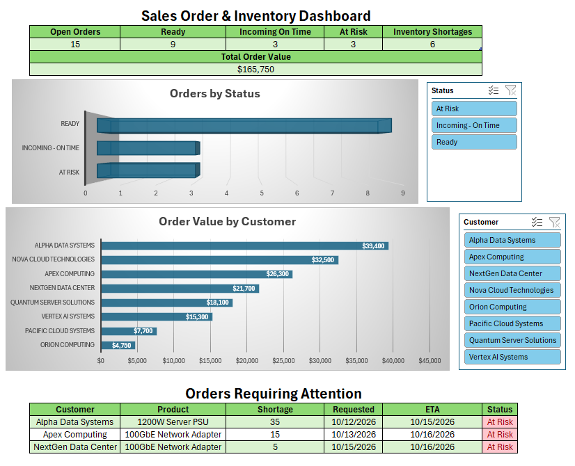
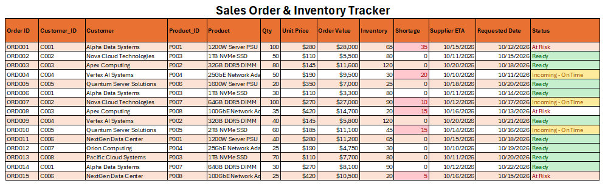

# Sales Order & Inventory Tracking Dashboard



## Overview

This project simulates a sales and order-fulfillment workflow for an
electronics and server hardware company.

The solution integrates customer orders, server-component inventory,
product pricing, purchasing data, supplier ETAs, and customer-requested
dates to monitor fulfillment status and identify orders requiring
attention.

Using Excel, SQL, and Python/Pandas, the project demonstrates data
integration, inventory shortage analysis, order-risk classification,
interactive dashboard reporting, and automated exception reporting.

## Business Problem

Sales and operations teams need to:

-   Track customer orders and fulfillment status
-   Monitor inventory availability
-   Follow up on purchasing and supplier ETAs
-   Identify inventory shortages and fulfillment risks
-   Prioritize orders requiring customer or supplier follow-up
-   Communicate accurate order status to customers
-   Produce daily operational and exception reports

## Sales Operations Workflow    

The project models a typical order-support workflow:

1. A customer places an order with a requested delivery date.
2. The sales/order team checks current inventory availability.
3. If inventory is insufficient, the shortage quantity is calculated.
4. Purchasing data is checked for incoming inventory and supplier ETA.
5. The supplier ETA is compared with the customer's requested date.
6. Orders are classified as Ready, Incoming - On Time, or At Risk.
7. At-risk orders are surfaced for sales, purchasing, and customer follow-up.
8. A Python/Pandas automation generates a daily exception report containing orders requiring attention.

## Tools & Technologies

-   **Microsoft Excel:** XLOOKUP, PivotTables, PivotCharts, slicers,
    conditional formatting, structured tables, KPI dashboard
-   **SQL:** JOIN, WHERE, GROUP BY, SUM, calculated fields, and ORDER BY
-   **Python:** Pandas, CSV processing, DataFrame merges, filtering,
    date comparison, and automated report generation
-   **Data Modeling:** Customer, product, sales-order, and
    purchase-order datasets connected with relational keys
-   **Domain:** Server hardware inventory, order fulfillment, purchasing
    ETAs, shortage analysis, and sales operations

## Technical Skills Demonstrated

-   **Sales & Order Operations:** Order tracking, fulfillment status
    monitoring, shortage identification, requested-date vs. supplier-ETA
    analysis, and exception management
-   **Inventory Analysis:** Inventory availability checks, shortage
    calculations, incoming supply tracking, and fulfillment risk
    identification
-   **Server Hardware Data:** Worked with simulated server components
    including server PSUs, NVMe SSDs, DDR5 DIMMs, and high-speed network
    adapters
-   **Excel Analytics:** XLOOKUP, PivotTables, PivotCharts, slicers,
    conditional formatting, structured tables, KPI reporting, and
    dashboard development
-   **SQL Analysis:** Multi-table JOINs, filtering, calculated fields,
    aggregation, GROUP BY, and ORDER BY for operational analysis
-   **Python / Pandas:** CSV ingestion, DataFrame joins, data
    transformation, date comparison, shortage calculation, exception
    filtering, and automated report generation
-   **Relational Data Integration:** Connected customer, product,
    sales-order, and purchase-order datasets using Customer ID and
    Product ID keys
-   **Data Validation & Reconciliation:** Cross-checked order
    quantities, inventory levels, supplier ETAs, requested dates, status
    classifications, and dashboard totals
-   **Operational Reporting:** Built an interactive dashboard and
    automated daily exception report to surface orders requiring
    immediate attention

## Features

-   Customer order tracking
-   Inventory shortage detection
-   Supplier ETA tracking
-   Order-risk classification
-   Interactive sales and inventory dashboard
-   KPI reporting
-   Customer-level order value analysis
-   At-risk order exception table
-   Customer and status slicers
-   Automated daily exception reporting

## Order Status Logic

Orders are classified using inventory availability and incoming supply
timing:

-   **Ready** --- Current inventory is sufficient to fulfill the
    customer order.
-   **Incoming - On Time** --- Current inventory is insufficient, but
    incoming inventory is expected on or before the customer's requested
    date.
-   **At Risk** --- Current inventory is insufficient and incoming
    inventory is expected after the customer's requested date.

This logic allows sales and operations teams to quickly prioritize
orders requiring customer or supplier follow-up.

## Dashboard

The Excel dashboard provides a consolidated view of:

-   Open orders
-   Ready orders
-   Incoming inventory expected on time
-   At-risk orders
-   Inventory shortages
-   Total order value
-   Orders by status
-   Order value by customer
-   Orders requiring immediate attention

Interactive slicers allow the user to filter the PivotTable/PivotChart
analysis by customer and order status.


## Order Tracker

The Order Tracker combines customer, product, order, inventory, supplier
ETA, and requested-date information into a single operational view.

Conditional formatting highlights inventory shortages and uses
status-based colors to make fulfillment risk easy to identify.



## SQL Analysis

The project includes `sql/analysis.sql` with operational queries
demonstrating relational analysis across customer, product, and order
data.

Example analyses include:

-   Inventory shortages by order
-   Customer order value
-   At-risk order identification
-   Order status and operational summaries

The SQL demonstrates multi-table joins, filtering, calculated fields,
aggregation, grouping, and sorting.

## Python Automation

A Python automation built with Pandas consolidates order, customer,
product, and purchase-order data to automatically identify orders
requiring attention.

The script:

-   Reads order, customer, product, and purchase-order CSV files
-   Joins datasets using customer and product identifiers
-   Calculates inventory shortages for each customer order
-   Determines the next incoming supplier ETA for each product
-   Compares supplier ETAs with customer-requested dates
-   Identifies orders where incoming inventory will arrive after the
    requested date
-   Automatically exports at-risk orders to a daily CSV exception report

The resulting `reports/daily_order_status.csv` provides a focused list
of orders requiring follow-up, reducing the need to manually review
every open order.

### Example Output

| Order | Customer | Issue | Shortage | ETA |
| --- | --- | --- | ---: | --- |
| ORD001 | Alpha Data Systems | Late incoming inventory | 35 | Oct 15 |
| ORD008 | Apex Computing | Late incoming inventory | 15 | Oct 16 |
| ORD015 | NextGen Data Center | Late incoming inventory | 5 | Oct 16 |

## Workflow

**Customer Orders → Inventory Check → Shortage Detection → Supplier ETA
Check → Risk Identification → Dashboard / Daily Exception Report**

## Project Structure

``` text
Sales-Order-Inventory-Dashboard/
├── README.md
├── data/
│   ├── customers.csv
│   ├── products.csv
│   ├── orders.csv
│   └── purchase_orders.csv
├── excel/
│   └── Sales_Order_Inventory_Dashboard.xlsx
├── python/
│   └── generate_daily_report.py
├── reports/
│   └── daily_order_status.csv
├── screenshots/
│   ├── dashboard_preview.png
│   └── order_tracker.png
└── sql/
    └── analysis.sql
```

## Data

All companies, customers, suppliers, orders, products, and transactions
in this project are synthetic and were created solely for portfolio
demonstration. No confidential or proprietary business data is used.
